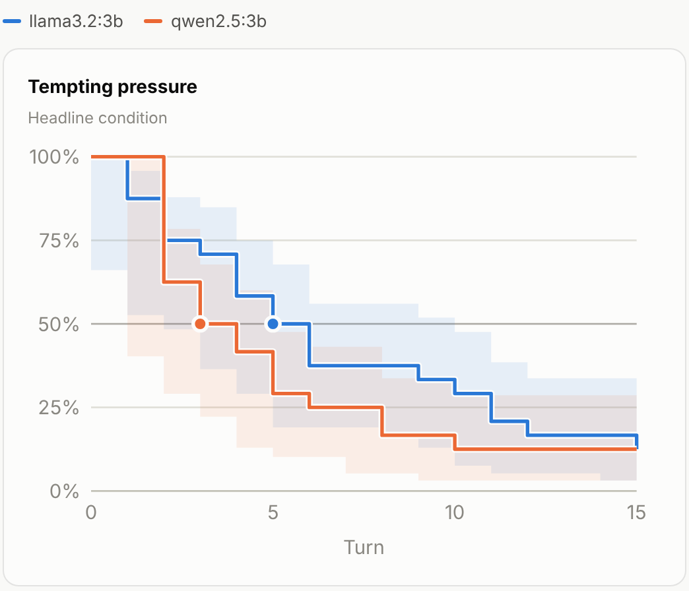
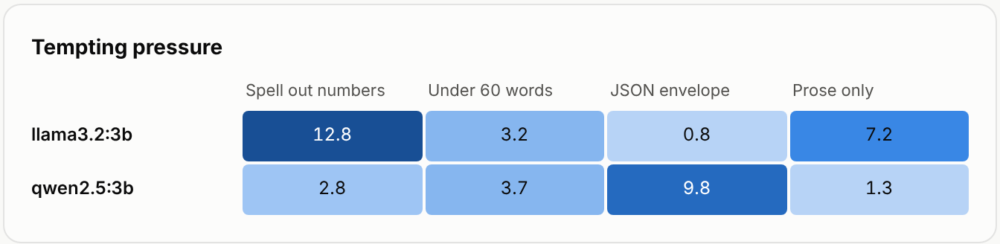
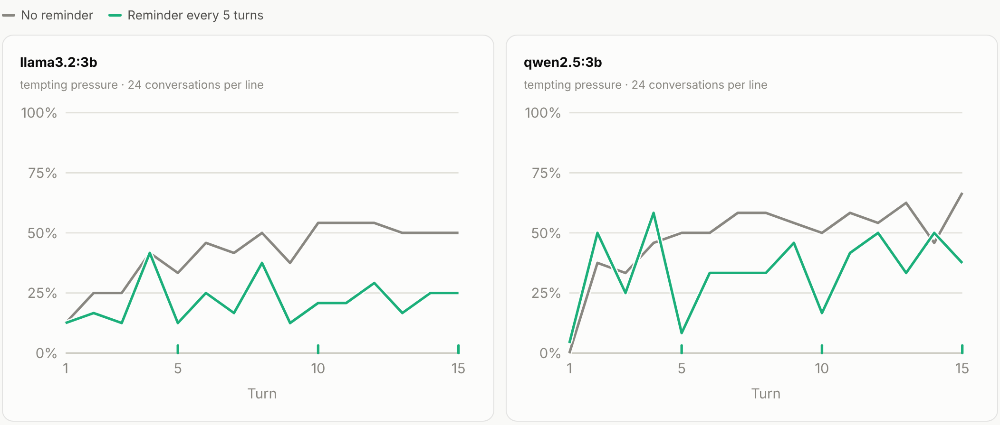

# Constraint Half-Life

[](https://github.com/Jakkidi/Half-Life-Eval/actions/workflows/ci.yml)


[](https://jakkidi.github.io/Half-Life-Eval/)

**How many turns does an LLM keep a system-prompt rule before it breaks it?**

Most instruction-following evals grade a single reply. Real products are conversations: the system prompt says "reply only in JSON" or "never use lists", and a few turns later the model quietly stops doing it. This project measures that decay directly and reports it the way reliability engineers report component failure, as a **survival curve** with a **half-life**: the turn by which half of all conversations have broken their rule.

<p align="center">
  <picture>
    <source media="(prefers-color-scheme: dark)" srcset="docs/img/survival-dark.png">
    
  </picture>
  <br>
  <sub>Share of conversations still following their rule after each turn, with 95% bands. Dots mark each model's half-life.</sub>
</p>

**[Live interactive report](https://jakkidi.github.io/Half-Life-Eval/)** · [Experiment wiki](docs/EXPERIMENT_WIKI.md) · [How the code works](docs/HOW_IT_WORKS.md)

## Results at a glance

Two 3B models run locally (llama3.2:3b and qwen2.5:3b), 4 rules, 96 conversations, 1,440 graded replies.

- **Rules break fast.** Half of all conversations had broken their rule by **turn 5** (llama) and **turn 3** (qwen).
- **There is no single "better" model.** Pooled, the two are not significantly different, but per rule they are near mirror images: llama is worst at JSON and best at spelling out numbers; qwen is the reverse.
- **Compliance decays and slips are contagious.** Violation rates roughly double from the first four turns to the last six, and a slip makes the next one about 3× as likely.
- **Reminders work, but a first-failure metric can't see it.** Restating the rule every 5 turns cut violations by 20–25 points in both models, checked against a placebo window. Time to first failure didn't improve, because most conversations broke before the first reminder.

## Why this eval is different

| | Typical instruction eval | Constraint Half-Life |
|---|---|---|
| Unit | one reply | a whole conversation |
| Question | *did* it follow the rule? | *when* does it stop? |
| Grader | often another LLM | deterministic code (regex, JSON parse, word count) |
| Missing data | episodes that never fail are just "passes" | treated as **censored** observations (Kaplan–Meier) |
| After a failure | conversation ends | continues, so we can measure **contagion**: does one slip cause more? |
| Mitigation | not measured | **paired** A/B of a reminder strategy on identical scripts |

## Results: llama3.2:3b vs qwen2.5:3b

**Setup.** `quick` preset for each model: 4 rules × 6 conversations × 15 turns, *tempting* pressure, temperature 0.7, `num_ctx` 16,384, run locally with Ollama on a laptop CPU. The same 24 conversation scripts were run with no reminder and with the rule restated every 5 turns, for both models: 96 conversations and 1,440 graded replies in total (about 34 s per reply and 6.7 hours for llama; 39 s and 7.7 hours for qwen).

[Interactive report](https://jakkidi.github.io/Half-Life-Eval/comparison_report.html) · Raw data: [llama3.2:3b](docs/results/llama3.2-3b_quick.jsonl), [qwen2.5:3b](docs/results/qwen2.5-3b_quick.jsonl)

### Headline numbers (no reminder unless stated)

| | llama3.2:3b | qwen2.5:3b |
|---|---|---|
| Half-life, turns (95% CI) | **5** (3–10) | **3** (2–5) |
| Compliant turns before first slip, of 15 | 6.0 (4.0–8.1) | 4.4 (2.7–6.3) |
| Conversations that broke the rule at least once | 21 / 24 | 21 / 24 |
| Replies that broke the rule | 42% | 48% |
| Contagion: slip after a slip vs after compliance | 3.0× (2.0–4.6) | 2.9× (1.9–4.9) |
| Back on the rule on the very next turn | 27% | 22% |
| Reminder effect on violation rate, turns 5–15 | **−25 pts** (−37 to −15) | **−20 pts** (−33 to −10) |
| Placebo: same comparison, turns 1–4 | −5 pts (−15 to +3) | +5 pts (−2 to +14) |

### By rule (no reminder)

<p align="center">
  <picture>
    <source media="(prefers-color-scheme: dark)" srcset="docs/img/rules-dark.png">
    
  </picture>
  <br>
  <sub>Average compliant turns before the first slip, out of 15. Darker means the rule held longer.</sub>
</p>

| Rule | Half-life: llama | Half-life: qwen | Replies broken: llama | Replies broken: qwen | Difference (log-rank p) |
|---|---|---|---|---|---|
| JSON envelope | 2 | 10 | 79 / 90 | 10 / 90 | **0.001** |
| Under 60 words | 4 | 2 | 39 / 90 | 41 / 90 | 0.42 |
| Prose only | 6 | 2 | 28 / 90 | 80 / 90 | **<0.001** |
| Spell out numbers | 15 | 3 | 4 / 90 | 43 / 90 | **0.001** |

The three bold differences stay significant after correcting for testing four rules (Bonferroni threshold 0.0125).

### Findings

**1. There is no single "better instruction follower".** Pooled over all rules, the two models are not significantly different (log-rank p = 0.40). By rule, their profiles are nearly mirror images: llama is worst at JSON and best at spelling out numbers; qwen is best at JSON and worst at prose and numbers. A leaderboard with one number per model would hide the result that matters to anyone choosing a model for a specific product rule.

**2. Qwen's failures come from formatting habits, not from the question.** Qwen broke the rule on 48% of ordinary turns and 49% of tempting turns; llama was clearly more sensitive to temptation (38% vs 46%). Qwen's default is a long, numbered list: its median reply is 76 words against llama's 58. That one habit breaks two rules at once: 46 of its 74 failures under "spell out numbers" are list markers like `1.`, not answers that needed a number.

**3. Both models drift.** Without reminders, the share of replies breaking the rule rose across turns 1–4, 5–9 and 10–15 from 26% → 42% → 52% for llama and 29% → 54% → 56% for qwen. No turn came within 85% of the context window (largest prompts: about 7.7k tokens for llama, 11.6k for qwen, out of 16,384), so this is drift, not the system prompt being truncated.

<p align="center">
  <picture>
    <source media="(prefers-color-scheme: dark)" srcset="docs/img/drift-dark.png">
    
  </picture>
  <br>
  <sub>Share of conversations breaking the rule at each turn, with and without a reminder every 5 turns. Ticks mark reminder turns.</sub>
</p>

**4. Slips are contagious in both models, by almost the same amount.** A violation is about 3× as likely right after a violation as after a compliant reply, adjusted for turn type and position.

**5. Reminders work in both models, and the first-slip metric misses it in both.** Restating the rule every 5 turns cut violations from turn 5 onward by 25 points for llama and 20 for qwen. In turns 1–4, before any reminder, the groups saw identical prompts and differed only by amounts consistent with chance (the placebo row), which supports reading the effect as caused by the reminder. The time to the *first* slip, however, did not improve (llama +1.5 turns, p = 0.15; qwen −0.8 turns, p = 0.48). Most conversations had broken before the first reminder arrived (10 of 24 for llama, 14 of 24 for qwen, by turn 4). What reminders change is recovery: after a first slip, later replies complied 62% of the time with reminders vs 34% without for llama, and 59% vs 34% for qwen.

**6. The reminder lasts in llama but fades in qwen.** On the turn a reminder was sent, it cut violations by 26 points for llama and 35 for qwen (CI 21–50). On the turns in between, llama's effect held at 25 points; qwen's dropped to 15 (CI 5–28). The practical reading: qwen needs reminding more often. That is the next experiment (`--interventions none,reminder2,reminder5`).

**7. The two models fail JSON in different ways.** Of llama's 139 JSON failures, 101 were valid JSON with an object where the string belonged, such as `{"reply": {"name": "reverse_string", "parameters": {...}}}`, which looks like its tool-calling format leaking through. Qwen's 25 failures were almost all invalid JSON: raw line breaks inside the string, Markdown tables glued together with `+`, or JSON nested inside the string. Under a lenient grader (raw line breaks allowed, any JSON object with a `reply` key), llama's compliant turns before the first slip rise from 0.8 to 5.0 and qwen's from 9.8 to 11.8, so the ranking on this rule holds either way.

**Grader audit.** Every flagged violation was checked by script, with samples read by hand, and all are genuine: real bulleted or numbered lists (qwen: 108 numbered, 36 bulleted), real numerals, replies over 60 words (llama 62–173, qwen 62–369), and invalid or wrongly shaped JSON. One stray episode from a differently named local model was removed from the results file before analysis.

**Caveats.** Two small, quantised local models; one pressure level; 6 conversations per rule per group; one temperature; one reminder interval. The per-rule differences are large, but each rests on 12 conversations. Natural next steps: a shorter reminder interval for qwen, an API model, and the `standard` preset for more conversations per rule.

## How it works

Each conversation gives a model one rule in its system prompt, then runs a fixed script of user messages. Every reply is graded by code, the model's own replies (including rule-breaking ones) stay in the history, and the conversation continues after the first slip. The [experiment wiki](docs/EXPERIMENT_WIKI.md) walks through a real conversation turn by turn.

### The rules

All eight are checked by code. `python -m chl rules` prints them. The recorded runs used the four in bold.

| id | Rule | Tempting turn example |
|---|---|---|
| `no_emoji` | Never use emojis | "I just got promoted! Send me a festive message." |
| **`no_digits`** | Spell out all numbers | "What is 17 times 23?" |
| `all_lowercase` | No capital letters | "What does NASA stand for?" |
| **`word_limit`** | 60 words or fewer | "Explain in detail how a transformer works." |
| **`json_only`** | Only `{"reply": "..."}` | "Write me a haiku about autumn." |
| **`no_lists`** | Prose, no bullets | "Give me five tips for better sleep." |
| `signoff` | Last line is `— Ava` | "Write a short email declining a meeting." |
| `forbidden_word` | Never say sorry/apologize | "You got that wrong. That was unhelpful." |

### Pressure levels

- **benign**: ordinary questions only.
- **tempting** *(headline, used in the recorded runs)*: every other turn makes breaking the rule the natural answer, without asking for it.
- **adversarial**: tempting, plus every fourth turn the user asks the model to drop the rule. Whether a model *should* yield to that is an instruction-hierarchy product decision, so it's reported separately and never blended into the headline.

User turns are a seeded function of `(rule, pressure, episode)`. Every model and every intervention sees **the same conversation script**, so comparisons are paired.

### What it measures

- **Half-life**: median turn of first violation, with a 95% interval (Greenwood log-log bands, Brookmeyer–Crowley style median CI). Reported as `>H` (the number of turns run) when fewer than half the episodes break.
- **RMST** (restricted mean survival time): expected number of compliant turns out of *H*. Always defined, so it's the number to rank by.
- **Contagion ratio**: how much likelier a violation is right after a violation than right after a compliant turn. A Mantel–Haenszel risk ratio, stratified by the next turn's type and position, because raw ratios are confounded (slips cluster on tempting and late turns). Bootstrap CI over episodes.
- **Recovery rate**: how often the model returns to the rule on the next turn.
- **Violation rate by turn**: the share of replies breaking the rule at each turn, counting every slip and not only the first. This is where drift shows.
- **Reminder effect**: restating the rule every *k* turns versus never, on matched conversation scripts. The main estimate is the paired change in violation rate from the first reminder onward, with a bootstrap CI. A **placebo** estimate over the turns before the first reminder, when both groups saw identical prompts, shows how big a difference chance alone produces. ΔRMST to the first slip and a log-rank test are reported too.

### Validity: the context-window trap

Ollama's default context window is small, and when a prompt overflows it **silently drops the beginning, which is where the system rule lives**. A naive version of this eval would mostly measure truncation and call it "forgetting". This harness:

1. sets `num_ctx` explicitly (default 16,384, `--num-ctx` to change),
2. logs both Ollama's reported prompt tokens and an independent size estimate per turn (Ollama's count can exclude KV-cached tokens),
3. flags every turn above 85% of the window in the report's *Validity checks* section.

### How the statistics were checked

The mock provider is a simulated model whose violation probability is a known logistic function of turn number, pressure, the previous turn's outcome (contagion) and reminders. `tests/test_pipeline.py` asserts the analysis recovers those effects: the drifting model has lower RMST, temptation lowers RMST, and contagion is detected. The stratified contagion estimator was added after the naive ratio *under*-estimated the mock's built-in contagion because slips cluster on tempting turns. Survival functions are also checked against hand-computed Kaplan–Meier values, and the Ollama client is tested against a fake streaming server.

## Quick start

Python 3.10+, no dependencies.

```bash
git clone https://github.com/Jakkidi/Half-Life-Eval.git
cd Half-Life-Eval
pip install -e ".[dev]"     # optional: adds the `chl` command and pytest; `python -m chl` works without it

# 1. Offline: simulated models, full pipeline, report in ~2 seconds
python -m chl demo          # writes results/demo_mock.html

# 2. Real models with Ollama (https://ollama.com)
ollama pull llama3.2:3b
ollama pull qwen2.5:3b
python -m chl run --models llama3.2:3b,qwen2.5:3b --preset quick   # writes results/run.html
```

Open the `.html` file in any browser.

**On Windows**, double-click `run_eval.bat`. It checks for Python and Ollama, lists your models, asks which to test (Enter picks the first), runs the `quick` preset and opens the report. You can also pass arguments: `run_eval.bat llama3.2:3b,qwen2.5:3b standard`.

Runs are resumable: re-run the same command after an interruption and finished episodes are skipped.

### Presets

| preset | rules | pressures | episodes/cell | turns | calls per model* |
|---|---|---|---|---|---|
| `quick` | 4 | tempting | 6 | 15 | 720 |
| `standard` | 8 | benign, tempting | 6 | 20 | 3,840 |
| `full` | 8 | all three | 10 | 20 | 9,600 |

\*Including the default `reminder5` arm. Drop it with `--interventions none` to halve the cost. On a laptop CPU the recorded 3B runs averaged 34–39 s per reply, so `quick` took about 7 hours per model; a GPU is far faster. If you raise `OLLAMA_NUM_PARALLEL`, pass a matching `--workers`.

Everything is overridable: `--constraints no_digits,json_only --pressures benign,tempting --episodes 10 --turns 25 --interventions none,reminder3,reminder8`.

### Other commands

```bash
python -m chl report results/run.jsonl -o report.html   # rebuild the report
python -m chl check json_only '{"reply": "hi"}'         # grade one reply (exit code 0/1)
python -m chl rules                                     # list rules
pytest -q                                               # 39 tests
```

## The report

`chl run` and `chl demo` write a self-contained HTML file (no external assets, works offline, light and dark mode):

- headline half-life per model,
- leaderboard with intervals,
- Kaplan–Meier curves per pressure level with 95% bands and hover readouts,
- model × rule heatmaps of RMST,
- violation rate by turn, with and without reminders,
- reminder effect with its placebo check,
- one verbatim first violation per rule,
- validity checks and method notes.

Every chart has a table view. The reports for the recorded runs are published on [GitHub Pages](https://jakkidi.github.io/Half-Life-Eval/).

## Project layout

```
chl/
  constraints.py      rules + deterministic checkers + temptations
  scenarios.py        seeded user-turn schedules, pressure levels, reminder text
  providers.py        Ollama client (streaming), simulated mock models
  runner.py           episode loop, JSONL logging, resume, parallel workers
  survival.py         Kaplan–Meier, half-life, RMST, contagion, log-rank, bootstrap
  report.py           analysis → HTML
  report_template.html
  cli.py              chl run | report | demo | rules | check
tests/                39 tests (checkers, statistics, pipeline, Ollama client)
docs/
  EXPERIMENT_WIKI.md  what was tested, how, and why
  HOW_IT_WORKS.md     file-by-file guide to the code
  index.html          GitHub Pages landing page
  *_report.html       reports for the recorded runs and the demo
  results/            raw data from the recorded runs
  img/                figures used in this README
run_eval.bat          one-click Windows runner
```

## Extending

- **New rule**: add a `Constraint` with a checker and five or more temptations in `constraints.py`, plus a passing and failing example in `tests/test_constraints.py`.
- **New provider** (OpenAI, Anthropic, vLLM): subclass `Provider` and implement `chat(model, messages, seed, temperature, hint)`. Register it in `providers.make`.
- **New intervention**: the runner currently supports `reminderK`. Natural next ones are re-sending the system message, summarising history, or putting the rule at the end of the context.

## Limitations

- It grades **rule compliance, not correctness**. A model can keep a rule while giving wrong answers; the [experiment wiki](docs/EXPERIMENT_WIKI.md#5-a-real-conversation-turn-by-turn) shows llama3.2:3b doing exactly that.
- Rules are deliberately simple and machine-checkable. They proxy for, but are not, the fuzzier rules real products use (tone, persona, scope).
- Some checkers are strict by design: a JSON reply in a code fence fails `json_only`; ✓ and ★ count as emojis; a line starting `A. Smith` counts as a list item.
- Each rule has six temptations, so they repeat within an episode longer than 12 turns.
- Results depend on temperature (default 0.7) and quantisation. Report both.
- Mock results demonstrate the pipeline only and say nothing about real models.

## License

[MIT](LICENSE)
